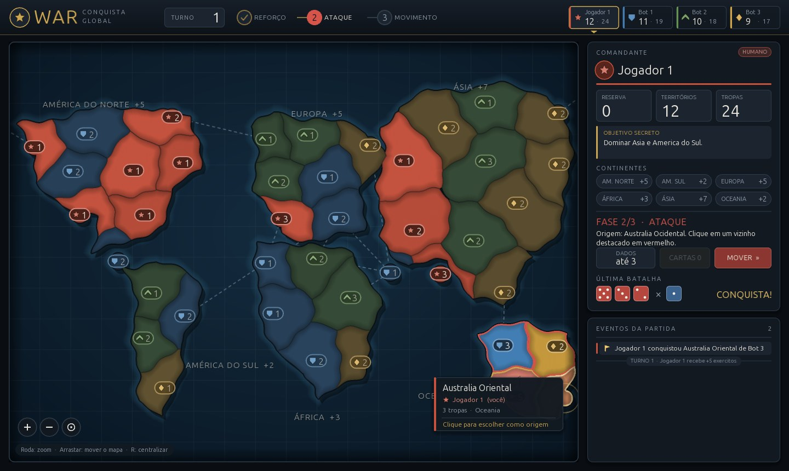
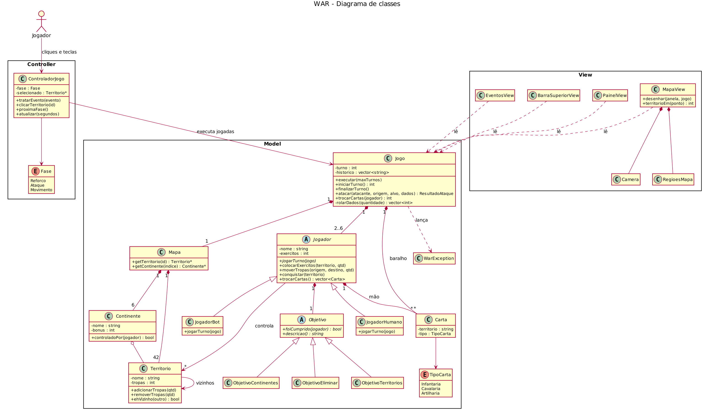

# Projeto WAR — Programação Orientada a Objetos em C++

Clone educacional do jogo de tabuleiro **WAR** para **2 a 6 jogadores**, com **interface gráfica em SFML** e também versão de terminal. Jogadores podem ser humanos ou bots. O foco é demonstrar os conceitos de POO de forma simples.



## Como compilar e executar (Linux / WSL)

Requisitos: `g++` com C++17 e `make` (`sudo apt install build-essential`). Para a interface gráfica: `sudo apt install libsfml-dev`.

```bash
make jogar      # compila e abre a interface grafica (1 humano contra 3 bots)
make            # compila o jogo de terminal (gera ./war)
make run        # partida com 3 jogadores humanos
make demo       # partida automatica entre 4 bots (seed 42)
make uml        # regenera docs/uml/classes.png a partir de classes.puml (requer plantuml)
```

Sem `make`, o comando equivalente é:

```bash
g++ -std=c++17 -Imodel model/*.cpp main/main.cpp -o war
```

Opções: `./war [--demo] [--jogadores N] [--seed N]` e `./war_gui [--jogadores N] [--humanos H] [--seed N]` (`--humanos 0` assiste a uma partida só de bots; `--humanos 4` é hot-seat).

## Interface gráfica (SFML)

| Ação | Como |
|---|---|
| Reforço | clique esquerdo coloca a *quantidade* escolhida; clique direito coloca todos os exércitos |
| Ataque | clique num território seu (origem) e depois num vizinho destacado em **vermelho**; usa até 3 dados |
| Movimento | clique na origem e depois num vizinho destacado em **verde** (cada tropa move 1 vez por turno) |
| Mapa | roda do mouse: zoom suave · arrastar: mover · setas/WASD · `R`: centralizar · botões ＋ − ⌖ |
| Próxima fase | botão do painel ou `Espaço` · trocar cartas: botão ou `T` · quantidade: `+`/`-` · limpar seleção: `Esc` |

Visual: territórios desenhados como regiões (diagrama de Voronoi gerado uma vez), sombreamento, costas e rotas marítimas; cada jogador tem cor e **emblema** próprios (★ ⛨ ⌃ ◆ ⬢ ✚); estados visuais normal / hover / selecionado / ação possível (vermelho = ataque, verde = movimento) / ação proibida (escurecido); seta de ataque e dica explicando o clique; barra superior com turno, etapas e resumo dos jogadores; painel do comandante (reserva, territórios, tropas, objetivo, continentes, dados da última batalha); painel de eventos com ícones; animações leves de seleção, conquista, movimentação e troca de turno.

## Comandos no terminal

| Fase | Comando | Exemplo |
|---|---|---|
| Reforço | `r ID QTD` coloca exércitos · `trocar` troca 3 cartas | `r 3 5` |
| Ataque | `a ORIGEM ALVO DADOS` · `passar` | `a 5 7 3` |
| Movimento | `m ORIGEM DESTINO QTD` · `fim` | `m 1 2 3` |
| Qualquer fase | `mapa` · `status` · `vizinhos ID` · `sair` | `vizinhos 12` |

## Regras implementadas

- Mapa clássico: 42 territórios, 6 continentes, fronteiras (inclusive Alasca–Kamtchatka).
- Territórios sorteados entre os jogadores, com 8 tropas extras aleatórias por jogador.
- Reforços: metade dos territórios (mínimo 3) + bônus de cada continente dominado.
- Ataque com até 3 dados contra até 3 da defesa; empate favorece a defesa.
- Movimentação entre territórios vizinhos próprios; cada exército se desloca só uma vez por turno e 1 tropa sempre fica na origem.
- Carta ao conquistar pelo menos um território no turno; troca de 3 cartas (iguais ou uma de cada) vale 4, 6, 8... exércitos; com 5 cartas a troca é obrigatória.
- Objetivos secretos sorteados: conquistar territórios, dominar dois continentes ou eliminar um adversário.
- Vence quem cumprir o seu objetivo durante o seu turno (ou eliminar todos).

## Estrutura

```
war-versao-final/
├── model/       regras do jogo (Jogo, Mapa, Territorio, Jogador, Objetivo...)
├── view/        renderizacao e interface SFML, sem regras: MapaView, Camera, RegioesMapa,
│                Animacoes, PainelView, EventosView, BarraSuperiorView, Tema.h, Desenho
├── controller/  ControladorJogo: transforma cliques/teclas em chamadas ao model
├── main/        main.cpp (terminal) e main_gui.cpp (janela)
├── assets/      fontes Ubuntu (Ubuntu Font Licence, livre para redistribuir)
├── docs/        diagrama de classes UML (PlantUML), descrição do diagrama e captura da interface
└── Makefile
```

## Conceitos de POO e onde encontrá-los

| Conceito | Onde |
|---|---|
| Classes e objetos | `Territorio`, `Continente`, `Mapa`, `Carta`, `Jogador`, `Jogo` |
| Encapsulamento | atributos `private`; tropas só mudam por `adicionarTropas`/`removerTropas`, que validam |
| Herança 1 | `Objetivo` → `ObjetivoTerritorios`, `ObjetivoContinentes`, `ObjetivoEliminar` |
| Herança 2 | `Jogador` → `JogadorHumano`, `JogadorBot` |
| Herança 3 | `WarException` → `std::runtime_error` |
| Polimorfismo / classe abstrata | `Objetivo::foiCumprido()` e `Jogador::jogarTurno()` são virtuais puros; `Jogador::ehAutomatico()` é sobrescrito por `JogadorBot` |
| Separação em camadas | `model/` (regras), `view/` (só desenha e consulta o model), `controller/` (entrada do usuário) |
| Composição | `Jogo` possui `Mapa` e jogadores; `Mapa` possui territórios e continentes; `Jogador` possui seu `Objetivo` |
| Agregação / associação | `Continente` aponta para territórios do `Mapa`; `Territorio` aponta para dono e vizinhos |
| Lambda | `Jogo::rolarDados` ordena os dados com `[](int a, int b) { return a > b; }` |
| Exceções | `WarException` lançada em jogadas inválidas e tratada com `try/catch` em `JogadorHumano`, `JogadorBot`, `ControladorJogo` (mensagem em vermelho no painel) e nos dois `main` |
| Coleções | `std::vector` e `std::string` em todo o projeto |

## Diagrama de classes (UML)

As classes de cada camada com seus atributos e métodos principais, as enumerações e as relações essenciais. O arquivo-fonte editável (PlantUML) é [`docs/uml/classes.puml`](docs/uml/classes.puml), e a explicação da notação está em [`docs/MODELAGEM_UML.md`](docs/MODELAGEM_UML.md).


